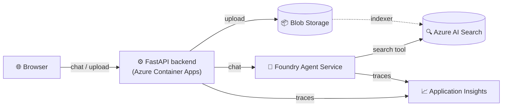

<div align="center">

# Azure Foundry RAG - Azure Foundry Agent Lab

**A Retrieval-Augmented Generation chat app built entirely on Azure services.**

[](LICENSE)
[](https://www.python.org/)
[](https://fastapi.tiangolo.com/)
[](https://azure.microsoft.com/)

</div>

Azure AI Foundry Agent Service answers questions grounded in your own documents — retrieved through Azure AI Search, stored in Azure Blob Storage, served through a streaming FastAPI backend on Azure Container Apps, and traced end-to-end with Application Insights.

## Contents

- [Features](#features)
- [Architecture](#architecture)
- [Prerequisites](#prerequisites)
- [Local development](#local-development)
- [Running with Docker](#running-with-docker)
- [Deploying to Azure Container Apps](#deploying-to-azure-container-apps)
- [Project structure](#project-structure)
- [License](#license)

## Features

- **Grounded answers** — the agent retrieves from your own documents via Azure AI Search and cites its sources.
- **Streaming responses** — token-by-token output over Server-Sent Events, no polling.
- **Document upload** — drop files straight into Blob Storage from the chat UI.
- **Full observability** — OpenTelemetry traces for every request, visible in Application Insights.
- **No secrets in code** — every Azure service is accessed with `DefaultAzureCredential` and RBAC, not API keys.
- **Container-ready** — a single Dockerfile takes you from laptop to Azure Container Apps.

## Architecture



The chat endpoint streams responses back to the browser over Server-Sent Events (SSE). The Foundry Agent is configured with an **Azure AI Search** tool pointing at a vectorized index built from the documents in Blob Storage, so answers are grounded in your own data and include source citations.

## Prerequisites

Before running this app you need the following Azure resources already provisioned:

1. An **Azure AI Foundry** project with:
   - A deployed chat model (e.g. `gpt-4o` or `gpt-4o-mini`).
   - A deployed embedding model (e.g. `text-embedding-3-small`).
   - An **Agent** configured with an **Azure AI Search** tool pointing at a vectorized search index.
2. An **Azure Storage** account with a Blob container holding the source documents.
3. An **Azure AI Search** service with an index + indexer that vectorizes the documents in the Blob container.
4. (Optional) An **Application Insights** resource for telemetry.

Identity used by the app (your own account for local development, or the app's managed identity in Azure) needs:

| Resource | Role |
|---|---|
| Azure AI Foundry project | `Foundry User` (assigned at the **project** scope) |
| Storage account | `Storage Blob Data Contributor` |

**New to these resources?** Follow the detailed, click-by-click walkthrough in **[docs/azure-setup.md](docs/azure-setup.md)** — it covers every Azure Portal screen above, plus the pitfalls we hit while building this project (region availability, RBAC scoping, registry authentication, and more).

## Local development

This project uses [`uv`](https://docs.astral.sh/uv/) for dependency management.

```bash
uv venv
uv pip install -r requirements.txt
```

Copy the example environment file and fill in your own resource values:

```bash
cp .env.example .env
```

| Variable | Description |
|---|---|
| `FOUNDRY_PROJECT_ENDPOINT` | Azure AI Foundry project endpoint, e.g. `https://<resource>.services.ai.azure.com/api/projects/<project>` |
| `FOUNDRY_AGENT_NAME` | Name of the Foundry Agent to use |
| `STORAGE_ACCOUNT_URL` | Blob endpoint, e.g. `https://<account>.blob.core.windows.net` |
| `STORAGE_CONTAINER_NAME` | Blob container name holding source documents (default: `documents`) |
| `APPLICATIONINSIGHTS_CONNECTION_STRING` | Optional. Enables OpenTelemetry tracing via Azure Monitor |

Authenticate with Azure so `DefaultAzureCredential` can pick up your identity:

```bash
az login
```

Run the app:

```bash
uv run uvicorn app.main:app --reload --host 0.0.0.0 --port 8000
```

Open `http://localhost:8000` and start chatting.

## Running with Docker

```bash
docker build -t azure-native-rag:latest .
docker run -p 8000:8000 --env-file .env azure-native-rag:latest
```

## Deploying to Azure Container Apps

1. Push the image to an Azure Container Registry.
2. Create a Container App from that image, with ingress enabled on port `8000`.
3. Enable a system-assigned managed identity on the Container App.
4. Grant the managed identity the roles listed in [Prerequisites](#prerequisites).
5. Set the environment variables from the table above on the Container App.

## Project structure

```
app/
├── main.py                 # FastAPI app and routes (/api/chat, /api/upload, /health)
├── config.py                # Environment-variable configuration
├── telemetry.py             # Azure Monitor OpenTelemetry setup
├── services/
│   ├── agent_client.py      # Azure AI Foundry Agent Service client
│   └── blob_service.py      # Azure Blob Storage client
└── static/
    └── index.html            # Minimal chat UI
docs/
└── azure-setup.md            # Step-by-step Azure Portal walkthrough
Dockerfile
requirements.txt
```

## License

Licensed under the [MIT License](LICENSE).
